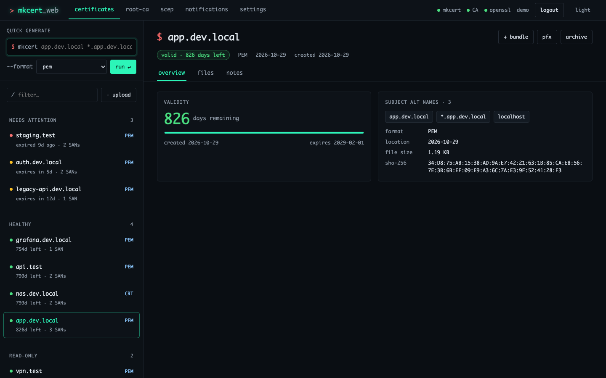
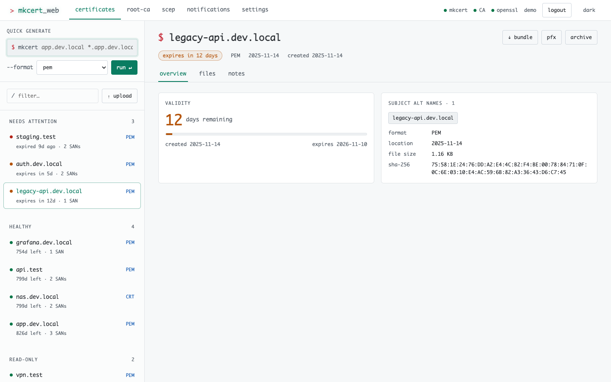
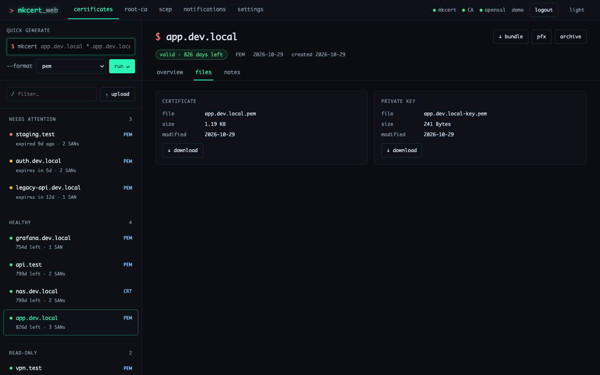
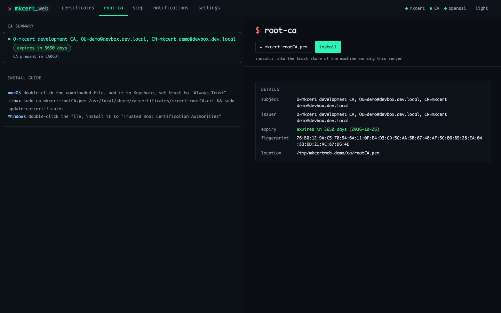
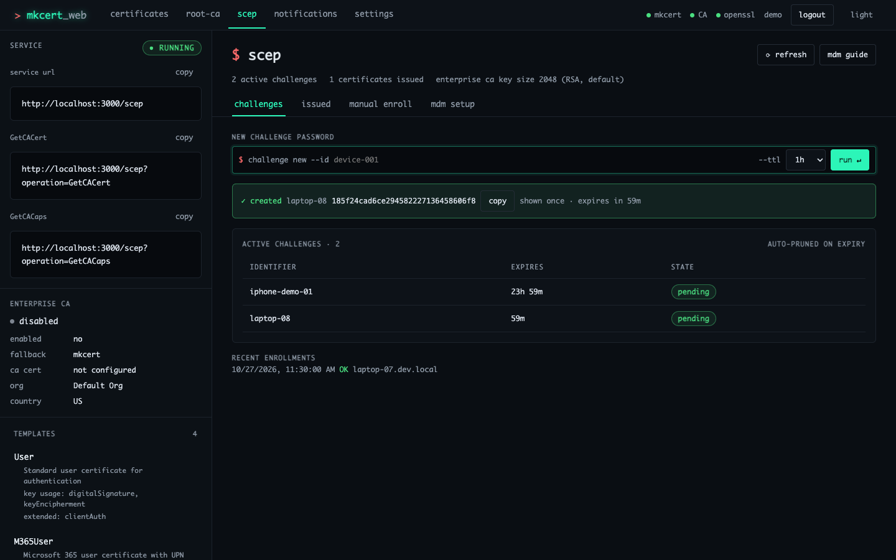
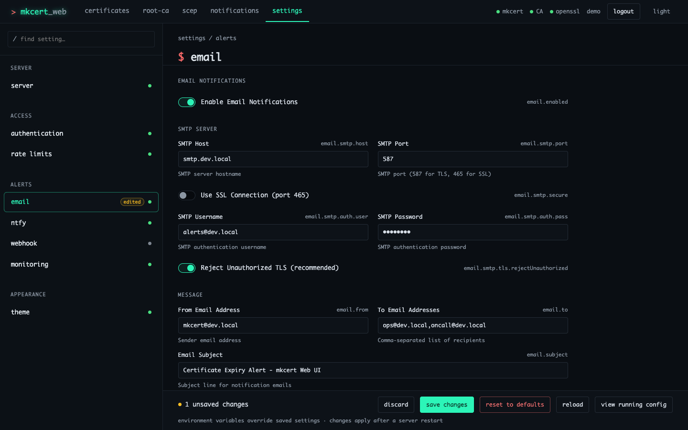
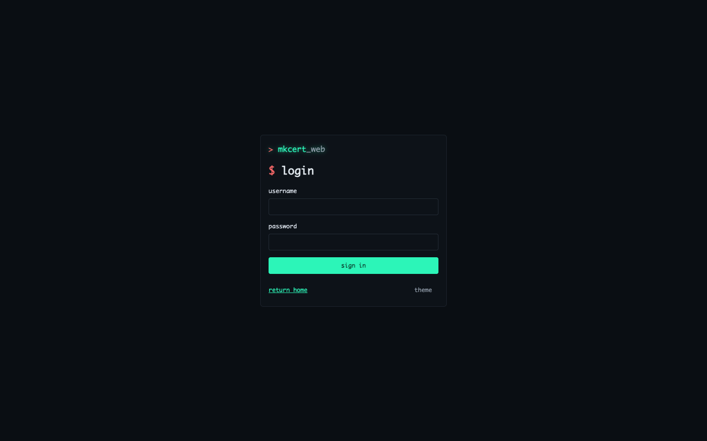
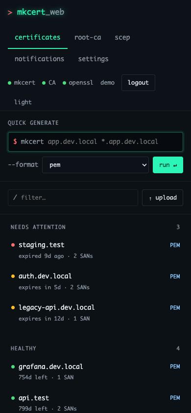

# mkcert Web UI

A web interface for [mkcert](https://github.com/FiloSottile/mkcert): generate,
inspect and manage locally-trusted TLS certificates, run a small SCEP server,
and get alerts before certificates expire.

[](LICENSE)
[](package.json)
[](https://hub.docker.com/r/jeffcaldwellca/mkcertweb)



## Features

**Certificates**
- Generate certificates for any mix of host names, wildcards and IPs in `pem`,
  `crt`, `p12` or `p12-client` (PKCS#12 with client auth) format.
- A list grouped by state (needs attention, healthy, read-only, archived) with
  days left, SANs, SHA-256 fingerprint and file details.
- Download the certificate, the key, or both as a ZIP; export a PFX.
- Upload existing `.pem`, `.crt`, `.key`, `.p12` and `.pfx` files (view-only).
- Archive and restore, without ever overwriting a certificate of the same name.
- A free-text note on each certificate.

**Root CA:** CA details and download, install instructions for macOS, Linux
and Windows, and CA generation for a fresh install (for example a new
container).

**SCEP:** GetCACaps, GetCACert and PKIOperation for device enrollment, one-time
challenge passwords, manual enrollment with templates, and an optional
enterprise CA. See [docs/SCEP.md](docs/SCEP.md).

**Notifications:** a scheduled expiry check that alerts by email (SMTP), ntfy
or HTTP webhook, with test buttons for each channel. See
[docs/EMAIL_MONITORING_GUIDE.md](docs/EMAIL_MONITORING_GUIDE.md).

**Settings:** a settings page that saves to `config/settings.json`, with
unsaved-change tracking and secret masking. See
[docs/SETTINGS.md](docs/SETTINGS.md).

**Authentication:** username/password login, optionally with OpenID Connect
single sign-on.

**Security:** CSRF tokens, a strict Content-Security-Policy, rate limits, and
an allowlist for every command the server runs. See [Security](#security).

**Interface:** a split-pane layout with light and dark themes that works down to
phone width.

## Screenshots

| | |
|---|---|
|  |  |
| Certificates (light) | Certificate files |
|  |  |
| Root CA | SCEP challenges |
|  |  |
| Notifications (monitoring) | Settings |
|  |  |
| Login | Phone width |

## Quick start

### Docker

```bash
git clone https://github.com/jeffcaldwellca/mkcertWeb.git
cd mkcertWeb
docker compose up -d
```

Open <http://localhost:3000>. The compose file runs
`jeffcaldwellca/mkcertweb:latest` with volumes for certificates, notes,
settings and the root CA. The image has no CA of its own: open **root-ca** and
press `generate`, then download `mkcert-rootCA.pem` and install it on the machines
that should trust your certificates. [docs/DOCKER.md](docs/DOCKER.md) covers
`docker run`, configuration, custom UIDs and backups.

### Local install

Requires Node.js 22 or later, mkcert and openssl.

```bash
git clone https://github.com/jeffcaldwellca/mkcertWeb.git
cd mkcertWeb
npm install
mkcert -install      # optional: create the CA and trust it on this machine
npm start            # http://localhost:3000
```

To run it as a service, use the systemd unit in
[`deploy/mkcert-web-ui.service`](deploy/mkcert-web-ui.service). It runs the
app as `www-data` with the code in `/opt/mkcert-web-ui` owned by root and
read-only to the service. Before the first start, create the directories it
writes to with
`cd /opt/mkcert-web-ui && sudo install -d -o www-data -g www-data certificates config data ssl`. The CA
lives in `/var/lib/mkcert-web-ui/ca` (`StateDirectory` + `CAROOT`). When
upgrading from an older unit, copy the existing `rootCA.pem` and
`rootCA-key.pem` there first, or mkcert creates a new CA. If you use the
enterprise CA, its directory must be writable for openssl's `.srl` serial file.
Details: [deploy/README.md](deploy/README.md).

## Configuration

Configuration comes from environment variables (a `.env` file in the working
directory is loaded at startup), from the settings page, and from built-in
defaults. **An environment variable that is set wins over the value saved on the
settings page**; saved settings win over defaults. Saved settings apply after a
restart, and the settings page only works with `ENABLE_AUTH=true`.
[`.env.example`](.env.example) lists every variable;
[docs/SETTINGS.md](docs/SETTINGS.md) explains the settings page.

| Variable | Default | Purpose |
|---|---|---|
| `PORT` / `HTTPS_PORT` | `3000` / `3443` | Listening ports |
| `ENABLE_HTTPS` | `false` | Also serve HTTPS with an mkcert certificate for `SSL_DOMAIN` |
| `SSL_DOMAIN` | `localhost` | Name on the HTTPS certificate |
| `FORCE_HTTPS` | `false` | With `ENABLE_HTTPS=true`, redirect every plain-HTTP request to the HTTPS port (301 for GET/HEAD, 308 for other methods), except `/api/health` and `/scep`. `X-Forwarded-Proto: https` counts only from a trusted proxy (`TRUST_PROXY`) |
| `TRUST_PROXY` | `loopback,linklocal,uniquelocal` | Which proxies may set `X-Forwarded-For` / `X-Forwarded-Proto` (client IP for rate limits, HTTPS detection). `true`, `false`, a hop count, or comma-separated addresses, CIDRs or `loopback`/`linklocal`/`uniquelocal`. The default trusts every private-LAN client; set it to your proxy's address as the app sees it (`loopback` without Docker; in Docker the network gateway or the proxy container's IP; see [docs/DOCKER.md](docs/DOCKER.md#https-and-reverse-proxies)). Environment only |
| `THEME_MODE` | `light` (`dark` in Docker) | Default theme for new browsers |
| `ENABLE_AUTH` | `false` | Require a login |
| `AUTH_USERNAME` | `admin` | Login name |
| `AUTH_PASSWORD` / `AUTH_PASSWORD_HASH` | random, printed at startup | Password, or a bcrypt hash of it |
| `SESSION_SECRET` | random per start | Session signing key; set it so sessions survive restarts |
| `ENABLE_OIDC`, `OIDC_ISSUER`, `OIDC_CLIENT_ID`, `OIDC_CLIENT_SECRET`, `OIDC_CALLBACK_URL`, `OIDC_SCOPE` | off | OpenID Connect sign-in (needs `ENABLE_AUTH=true`) |
| `ALLOWED_ORIGINS` | empty | Origins allowed cross-origin requests |
| `CLI_RATE_LIMIT_*`, `API_RATE_LIMIT_*`, `AUTH_RATE_LIMIT_*` | 10 / 100 / 5 per 15 min | Rate limits (`_WINDOW` in ms, `_MAX`) |
| `UPLOADED_CERTS_DIR` | `certificates/uploaded` | Where uploads are saved |
| `CERT_MONITORING_ENABLED`, `CERT_CHECK_INTERVAL`, `CERT_WARNING_DAYS`, `CERT_CRITICAL_DAYS` | off, `0 8 * * *`, 30, 7 | Expiry monitoring |
| `EMAIL_NOTIFICATIONS_ENABLED`, `SMTP_*`, `EMAIL_*` | off | Email alerts |
| `NTFY_ENABLED`, `NTFY_*` | off | ntfy alerts |
| `WEBHOOK_ENABLED`, `WEBHOOK_URL` | off | Webhook alerts |
| `SCEP_ALLOW_OPEN_ENROLLMENT`, `SCEP_ALLOWED_DOMAINS` | off, any | SCEP enrollment policy |
| `ENTERPRISE_CA_*` | off | Sign SCEP manual enrollments with your own CA |
| `CAROOT` | mkcert's default | Where mkcert keeps the root CA |

For OIDC, register `OIDC_CALLBACK_URL` (for example
`https://mkcert.dev.local/auth/oidc/callback`) with your provider, plus
`<same origin>/login` as a post-logout redirect URI. The issuer must serve
`/.well-known/openid-configuration`.

## Pages

| Page | What it does |
|---|---|
| **certificates** (`/`) | Quick generate, filter, upload; the grouped list on the left; overview, files and notes for the selected certificate on the right |
| **root-ca** | CA summary and details, download, install guide; generate when no CA exists |
| **scep** | Service URLs, enterprise CA status, templates; challenges, issued certificates, manual enrollment, MDM setup |
| **notifications** | Status and test actions for email, ntfy, webhook and monitoring; certificates currently expiring |
| **settings** | Every setting by section, with search, unsaved-change tracking and the running configuration |
| **login** | Username/password and, when configured, SSO (only with `ENABLE_AUTH=true`) |

Every page except login shares a top bar with the page tabs, mkcert / CA /
openssl status dots, the user and logout button, and the theme toggle.

## API

The UI uses a JSON API under `/api`; `GET /api` lists every route. Mutating
requests need a CSRF token from `GET /api/csrf-token`, and most routes need a
session when auth is on. [docs/API.md](docs/API.md) documents each route, the
response envelope, rate-limit tiers and the archive/restore rules.

## Security

With `ENABLE_AUTH` off, every route is open to anyone who can reach the server,
including issuing and deleting certificates and generating or installing the
root CA. See [What is protected without `ENABLE_AUTH`](docs/API.md#what-is-protected-without-enable_auth).

- **Authentication:** passwords are bcrypt-hashed at startup and compared in
  constant time; the session ID is rotated at login. OIDC uses discovery, the
  `state` parameter, PKCE when the provider supports it, and RP-initiated logout.
- **Sessions:** `httpOnly`, `sameSite=lax` cookies; with `ENABLE_HTTPS=true`
  the cookie is `secure` on HTTPS connections.
- **CSRF:** a per-session token on every mutating request.
- **Content-Security-Policy:** same-origin only, no `unsafe-inline` for scripts
  or styles, no inline event handlers, no CDNs; `frame-ancestors 'none'`.
- **Rate limits:** separate limits for certificate operations, API calls, logins
  and pages.
- **Commands:** only `mkcert` and `openssl` run, through `execFile` (no shell)
  with an argument allowlist; file names and paths are validated against
  traversal.
- **Errors:** a 500 carries a fixed message and a `ref`, never paths, stderr
  or stack traces; the server log has the full error under the same `ref`.
- **Guarded operations:** the settings API is disabled unless `ENABLE_AUTH=true`, secrets
  are masked in responses, `mkcert -uninstall` needs `ENABLE_AUTH=true` plus explicit
  confirmation, and SCEP enrollment needs a one-time challenge password unless
  you turn on open enrollment.

Don't expose the UI to the internet with authentication off. Report
vulnerabilities as described in [SECURITY.md](SECURITY.md).

## Project structure

```
mkcertWeb/
├── server.js            Express app: middleware, auth, routers, HTTP/HTTPS servers
├── src/
│   ├── config/          config loader (defaults, settings.json, env) and CSP
│   ├── middleware/      CSRF and rate limiting
│   ├── routes/          certificates, files (upload), notifications, scep, settings, system
│   ├── security/        command allowlist, path and filename validation
│   ├── services/        email, ntfy, webhook, expiry monitor, notes store
│   └── utils/           certificate parsing, PKCS#7/SCEP, enterprise CA, responses
├── public/
│   ├── *.html           one file per page
│   ├── css/app.css      the whole stylesheet
│   ├── js/              core, shell, models and one controller per page
│   └── assets/          icons and web manifest
├── test/                node --test suites
├── docs/                guides, API reference, screenshots, landing page (GitHub Pages)
├── deploy/              systemd unit
├── examples/            SMTP presets and an iOS SCEP profile
├── Dockerfile, docker-compose.yml, docker-build-push.sh
└── .env.example
```

At runtime the app creates `certificates/`, `config/`, `data/` and (with HTTPS)
`ssl/` in its working directory.

## Development

```bash
npm install
npm run dev          # restart on change
npm test             # all tests
npm run https-dev    # dev server with HTTPS on 3443 (creates ssl/ with mkcert)
```

These use mkcert's default CA directory (`mkcert -CAROOT`); `https-dev` signs its
certificate with that CA and mkcert creates one there if none exists. To keep
your real CA out of it, prefix the command with a scratch `CAROOT`, for example
`CAROOT=/tmp/mkcert-scratch-ca npm run https-dev` (see
[CONTRIBUTING.md](CONTRIBUTING.md#development-setup)).

There is no build step. See [CONTRIBUTING.md](CONTRIBUTING.md) for the
architecture, design and security rules, and [docs/TESTING.md](docs/TESTING.md)
for the test suites and a manual checklist.

## Troubleshooting

| Problem | What to check |
|---|---|
| Status dot `mkcert` or `openssl` is red | The binary isn't on the server's `PATH`: `mkcert -help`, `openssl version` |
| Status dot `CA` is red | No CA in `mkcert -CAROOT`. Generate one on root-ca, or point `CAROOT` at an existing one (in Docker, mount the CA volume) |
| Browsers don't trust generated certificates | Install `mkcert-rootCA.pem` (downloaded from root-ca) in each client's trust store, then restart the browser |
| install on root-ca fails | It installs into the server's own trust store and needs root; in Docker or under the systemd unit, install the CA on clients instead |
| Login password unknown | With `AUTH_PASSWORD` unset (or `admin`), a random one is printed in the server log at each start |
| Logged out after every restart | Set `SESSION_SECRET` |
| settings page says the API is disabled | Set `ENABLE_AUTH=true` and restart |
| A saved setting has no effect | Restart; if it still differs, the same setting is set as an environment variable (including `.env` or the Docker image's defaults) |
| Page unstyled over plain HTTP from another machine | The CSP's `upgrade-insecure-requests` makes the browser request assets over HTTPS; use HTTPS or a TLS proxy |
| Restore returns 409 `SWAP_INCOMPLETE` | An interrupted swap left `.swap-*` files in the archive folder; see [docs/API.md](docs/API.md#recovering-from-an-interrupted-swap) |
| 429 responses | Rate limit reached; wait for the window or raise `*_RATE_LIMIT_MAX` |
| Port in use | `PORT=3001 npm start` |

## License

GPLv3. See [LICENSE](LICENSE).

Built on [mkcert](https://github.com/FiloSottile/mkcert) by Filippo Valsorda.
