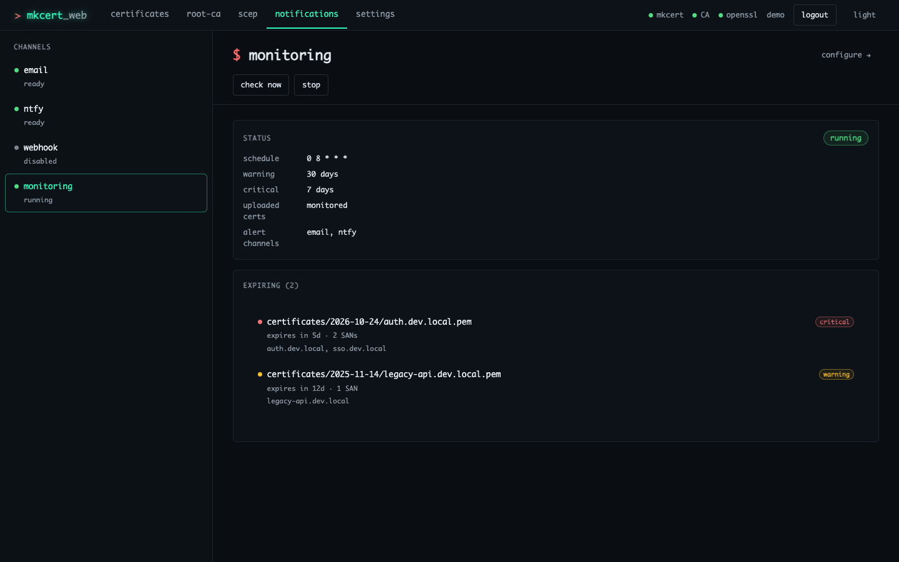

# Notifications and expiry monitoring

The expiry monitor scans `certificates/` on a cron schedule and sends an alert
through every enabled channel: email (SMTP), ntfy and a generic HTTP webhook.
The **notifications** page shows each channel's status and has test buttons.



## How the monitor works

- It runs only when `CERT_MONITORING_ENABLED=true`. It starts with the server,
  runs a first check about 5 seconds later, and then follows
  `CERT_CHECK_INTERVAL` (cron syntax, evaluated in UTC).
- It looks at every `.pem` certificate (not `-key.pem`) under `certificates/`,
  including archived, uploaded and SCEP ones.
- A certificate is **expiring** when it has between 0 and `CERT_WARNING_DAYS`
  days left, and **critical** when it has `CERT_CRITICAL_DAYS` or fewer.
  Certificates that have already expired are not reported.
- When something is expiring, one alert listing all of them goes to each enabled
  channel. If no channel is enabled the list is only logged.

## Configuration

Set these as environment variables (see [`.env.example`](../.env.example) and
the files in [`examples/`](../examples/)) or on the settings page. Saved
settings apply after a restart, and environment variables that are set win over
saved settings (see [SETTINGS.md](SETTINGS.md#where-a-value-comes-from)).

### Monitoring

| Variable | Default | |
|---|---|---|
| `CERT_MONITORING_ENABLED` | `false` | Run the scheduled check |
| `CERT_CHECK_INTERVAL` | `0 8 * * *` | Cron expression (daily at 08:00 UTC) |
| `CERT_WARNING_DAYS` | `30` | Warn this many days before expiry |
| `CERT_CRITICAL_DAYS` | `7` | Mark as critical at this many days |
| `CERT_MONITOR_UPLOADED` | `true` | Also scan the uploaded folder |

`CERT_MONITOR_UPLOADED` scans `certificates/uploaded/` a second time on top of
the full `certificates/` scan, so an expiring uploaded certificate is listed
twice. Set it to `false` unless `UPLOADED_CERTS_DIR` points outside
`certificates/`.

### Email

| Variable | Default | |
|---|---|---|
| `EMAIL_NOTIFICATIONS_ENABLED` | `false` | |
| `SMTP_HOST` | — | Required |
| `SMTP_PORT` | `587` | |
| `SMTP_SECURE` | `false` | `true` for implicit TLS (usually port 465) |
| `SMTP_USER`, `SMTP_PASSWORD` | — | Both required |
| `SMTP_TLS_REJECT_UNAUTHORIZED` | `true` | Set `false` only for a server with a self-signed certificate |
| `EMAIL_FROM` | `mkcert-web-ui@localhost` | |
| `EMAIL_TO` | — | Required; comma-separated |
| `EMAIL_SUBJECT` | `Certificate Expiry Alert - mkcert Web UI` | |

The channel counts as configured only when host, user, password and recipients
are all set, so an SMTP relay without authentication can't be used.
Provider examples: [`examples/email-gmail.env`](../examples/email-gmail.env),
[`email-outlook.env`](../examples/email-outlook.env),
[`email-corporate.env`](../examples/email-corporate.env). Gmail needs an app
password (2-step verification on, then <https://myaccount.google.com/apppasswords>).

### ntfy

| Variable | Default | |
|---|---|---|
| `NTFY_ENABLED` | `false` | |
| `NTFY_URL` | `https://ntfy.sh` | Server base URL |
| `NTFY_TOPIC` | — | Required |
| `NTFY_TOKEN` | — | Bearer token; used instead of username/password when set |
| `NTFY_USERNAME`, `NTFY_PASSWORD` | — | Basic auth for self-hosted servers |

Alerts are sent with ntfy priority `high`, or `urgent` when any certificate is
critical. `NTFY_PRIORITY` is shown on the notifications page but not used for
alerts.

### Webhook

| Variable | Default | |
|---|---|---|
| `WEBHOOK_ENABLED` | `false` | |
| `WEBHOOK_URL` | — | Required; receives a JSON `POST` |

The payload has `title`, `message`, `severity` (`warning` or `critical`),
`timestamp`, `certificates` (`path`, `domains`, `daysUntilExpiry`, `expiry`,
`priority`) and `summary` (`total`, `critical`, `warning`). The settings page
shows an example. Any 2xx response counts as delivered. Custom headers can only
be set by editing `config/settings.json` (see
[SETTINGS.md](SETTINGS.md#webhook-headers)).

## The notifications page

The left pane lists `email`, `ntfy`, `webhook` and `monitoring` with a status
(`ready`, `not configured`, `disabled`, `running`, `stopped`). Selecting one
shows its configuration and actions:

| Channel | Actions |
|---|---|
| email | `verify smtp` (connects without sending), `send test` |
| ntfy | `send test` |
| webhook | `send test` |
| monitoring | `check now` (runs a check and sends alerts), `start` / `stop` the schedule; lists the certificates currently expiring |

Actions are disabled until the channel is enabled and configured. Results are
logged under the actions for the current page view. `configure →` opens the
matching settings section. `start` and `stop` affect the running process only;
the next restart follows `CERT_MONITORING_ENABLED` again.

## Testing a setup

1. Configure the channel and restart the server.
2. On **notifications**, select the channel and press `send test` (for email,
   `verify smtp` first).
3. To see a real alert, lower the thresholds temporarily, for example
   `CERT_WARNING_DAYS=3650`, restart, and press `check now` on **monitoring**.
   Remember to set it back.

The same actions are available from the API; see
[API.md](API.md#notifications-and-monitoring). Every `POST` needs a session (when
auth is on) and a CSRF token:

```bash
curl -b jar http://localhost:3000/api/monitoring/expiring
curl -b jar -X POST -H "X-CSRF-Token: $TOKEN" http://localhost:3000/api/email/test
```

## Troubleshooting

- **email `not configured`:** host, user, password and `EMAIL_TO` must all be set.
- **Authentication failed (Gmail/Outlook):** use an app password and the full
  address as `SMTP_USER`.
- **Self-signed SMTP certificate:** `SMTP_TLS_REJECT_UNAUTHORIZED=false`.
- **monitoring `disabled`:** set `CERT_MONITORING_ENABLED=true` and restart.
  An invalid `CERT_CHECK_INTERVAL` stops the scheduler from starting; the server
  log says why.
- **Nothing in the expiring list:** only certificates with 0 to
  `CERT_WARNING_DAYS` days left are listed.
- The test buttons and actions use the `cli` rate limit (10 requests per
  15 minutes by default).
